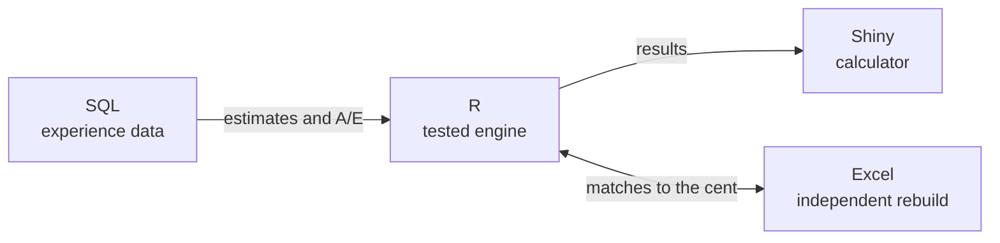

# The Odds of a Lifetime

*One policy, every way a life can unfold.*

      

**[▶ Try the live calculator](https://soodpratham10.shinyapps.io/odds-of-a-lifetime/)** (no installation needed)

## Prologue

Someone signs an insurance policy today. In return for a premium, an insurer makes a promise about a future nobody can predict, one that may not be tested for decades.

Then life happens. They might fall ill and recover, or not. They might stop paying and walk away. They might share the promise with a partner, retire on it, or count on a guarantee buried in the fine print. Every one of those paths has odds, and every path costs something.

This project prices those odds, one chapter at a time. Together the chapters answer one question:

> Once a promise is sold, how much must the insurer hold to keep it, and why did the result differ from what was expected?

## The chapters

Click a chapter to read it: the story, the mathematics, the experience data and the checks.

| Chapter | The story | Actuarial model | Headline result | Status |
|---|---|---|---|---|
| 1. [**Detours**](docs/chapters/01-detours.md) | Life doesn't go in a straight line | Multiple state models | Excel matches R to the cent | ✅ Done |
| 2. [**Exits**](docs/chapters/02-exits.md) | Everyone leaves eventually, but how? | Multiple decrement models | Lapses cut the premium by 14% | ✅ Done |
| 3. [**Two Lives**](docs/chapters/03-two-lives.md) | A promise made to a couple | Multiple life models | Matches the SOA life table | ✅ Done |
| 4. **The Long Wait** | Decades of saving for the years after work | Pension mathematics | | Next |
| 5. **The Reckoning** | Did the promise pay off for the insurer? | Profit testing and surplus | | Planned |
| 6. **Room to Move** | A promise that bends | Universal life | | Planned |
| 7. **The Fine Print** | Guarantees that cost more than they look | Embedded options | | Planned |

## How each chapter is built

Every chapter follows the same path and uses the same four tools.

| Tool | Its job |
|---|---|
| **R** | The engine: every model built from first principles, with automated tests |
| **SQL (SQLite)** | Where the odds come from: simulated experience data, summarised with SQL and compared with the assumptions |
| **Excel** | A second opinion: each chapter rebuilt independently in spreadsheet formulas |
| **Shiny** | The calculator: one tab per chapter, live online |

## How correctness is checked

1. **Automated tests:** 89 checks against answers worked out by hand or derived as closed-form formulas
2. **Experience data:** every model is tested against simulated experience, and the data recovers the assumptions
3. **Excel rebuilds:** every chapter implemented separately in spreadsheet formulas, matching R to the cent
4. **Published tables:** results compared with the SOA Standard Ultimate Life Table

The rates and data are illustrative and simulated, **not calibrated to real experience**, and not a pricing basis.

## Explore

- **[Getting started](docs/getting-started.md):** run the tests, build the database and open the calculator on your own computer
- **[Live calculator](https://soodpratham10.shinyapps.io/odds-of-a-lifetime/):** try it in your browser

## About

Built alongside my actuarial coursework at the University of Manitoba. Notation follows Dickson, Hardy and Waters, *Actuarial Mathematics for Life Contingent Risks*. Course notes and exam material are not included in this repository.

License: MIT
