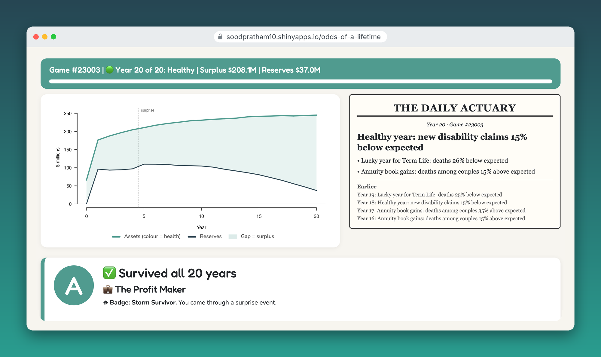
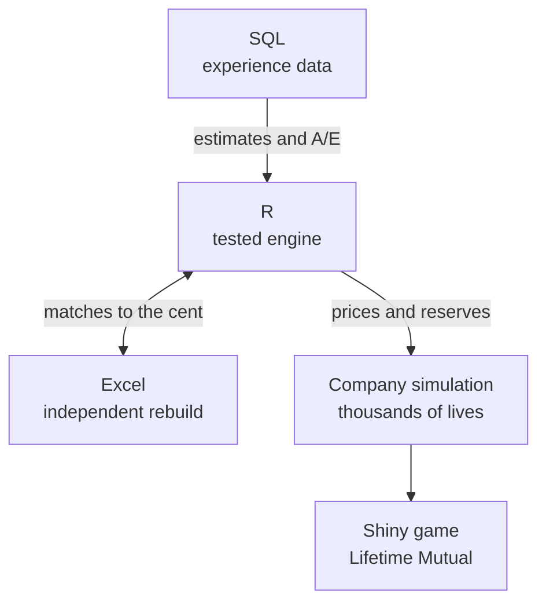

# The Odds of a Lifetime

*One policy, every way a life can unfold.*

      

**[▶ Play Lifetime Mutual](https://soodpratham10.shinyapps.io/odds-of-a-lifetime/)** (in your browser, no installation needed)

## You've just been made Chief Actuary

**Lifetime Mutual** is a game built on a tested actuarial engine. You choose which insurance products to sell and set their prices. Then the next 20 years play out with thousands of simulated customers: some fall ill, some die, some walk away, couples lose a partner, and interest rates may not be kind.

Each year the company pays claims, holds reserves for its future promises, and earns interest. Price too low and it goes bankrupt. Price too high and nobody buys.

- 🟢 **Healthy**, 🟡 **Warning** or 🔴 **Bankrupt**, judged each year on assets against reserves
- 📰 **The Daily Actuary** reports each year's news, from actual vs expected claims
- 👤 **Customer stories**: three real lives from your own simulation
- 🏆 **A report card** with a grade, a title and what the business paid out
- ⚡ **Hard mode**: a surprise pandemic, sickness wave, lapse wave or market crash, as in a stress test
- 🎲 **Game numbers**: replay anyone's exact luck, or keep the luck fixed and change only the price

**[How the game works →](docs/the-game.md)**

## Prologue

Someone signs an insurance policy today. In return for a premium, an insurer makes a promise about a future nobody can predict, one that may not be tested for decades.

Then life happens. They might fall ill and recover, or not. They might stop paying and walk away. They might share the promise with a partner, retire on it, or count on a guarantee buried in the fine print. Every one of those paths has odds, and every path costs something.

This project prices those odds, one chapter at a time, and each chapter becomes a product in the game. Together the chapters answer one question:

> Once a promise is sold, how much must the insurer hold to keep it, and why did the result differ from what was expected?

## The chapters

Click a chapter to read it: the story, the mathematics, the experience data and the checks.

| Chapter | The story | Actuarial model | In the game | Status |
|---|---|---|---|---|
| 1. [**Detours**](docs/chapters/01-detours.md) | Life doesn't go in a straight line | Multiple state models | 🏥 Disability Income | ✅ Done |
| 2. [**Exits**](docs/chapters/02-exits.md) | Everyone leaves eventually, but how? | Multiple decrement models | 🛡 Term Life | ✅ Done |
| 3. [**Two Lives**](docs/chapters/03-two-lives.md) | A promise made to a couple | Multiple life models | 💑 Couples Annuity | ✅ Done |
| 4. **The Long Wait** | Decades of saving for the years after work | Pension mathematics | 🔒 Company Pension | Next |
| 5. **The Reckoning** | Did the promise pay off for the insurer? | Profit testing and surplus | The yearly accounts | Planned |
| 6. **Room to Move** | A promise that bends | Universal life | 🔒 Flexible Life | Planned |
| 7. **The Fine Print** | Guarantees that cost more than they look | Embedded options | 🔒 Guaranteed Product | Planned |

## How it's built

Each chapter follows the same path. The game then runs every product through one company.

| Tool | Its job |
|---|---|
| **R** | The engine: every model built from first principles, with automated tests |
| **SQL (SQLite)** | Where the odds come from: simulated experience data, summarised with SQL and compared with the assumptions |
| **Excel** | A second opinion: each chapter rebuilt independently in spreadsheet formulas |
| **Shiny** | The game, plus each chapter's calculator under "How it works" |

## The actuarial work inside the game

| Step | What the engine does | Code |
|---|---|---|
| **Pricing** | Gross premiums by the equivalence principle, with commission, set-up and admin expenses | `r/expenses.R`, `r/simulate_company.R` |
| **Reserving** | Thiele's differential equations for disability; recursions for term life and the couples annuity | `r/reserves.R` |
| **Projection** | Every customer simulated year by year; cash flows rolled up with the interest actually earned | `r/simulate_company.R` |
| **Solvency** | Assets against reserves each year: healthy, warning or bankrupt | `run_company()` |
| **Monitoring** | Actual vs expected claim events each year, reported as headlines | `r/simulate_company.R`, `app/app.R` |
| **Stress testing** | One-year shocks to death, disability or lapse rates, or a fall in interest | `make_shock()` |

## How correctness is checked

1. **Automated tests:** 176 checks against answers worked out by hand or derived as closed-form formulas
2. **Fair price breaks even:** simulating 20,000 customers at the fair price gives a present value of profit close to zero for each product
3. **Stories add up:** every customer's premiums and benefits sum exactly to the company's yearly accounts
4. **Experience data:** every model is tested against simulated experience, and the data recovers the assumptions
5. **Excel rebuilds:** every chapter implemented separately in spreadsheet formulas, matching R to the cent
6. **Published tables:** results compared with the SOA Standard Ultimate Life Table

The rates and data are illustrative and simulated, **not calibrated to real experience**, and not a pricing basis. The company model is deliberately simple: no taxes, no reinsurance yet, one block of business sold at the start.

## Explore

- **[How the game works](docs/the-game.md):** pricing, sales, reserves, solvency, headlines and shocks
- **[Getting started](docs/getting-started.md):** run the tests, build the database and open the game on your own computer
- **[Play the game](https://soodpratham10.shinyapps.io/odds-of-a-lifetime/)** in your browser
- **[v0.3.0](https://github.com/soodpratham10/odds-of-a-lifetime/releases/tag/v0.3.0):** the earlier calculator-only version

## About

Built alongside my actuarial coursework at the University of Manitoba. Notation follows Dickson, Hardy and Waters, *Actuarial Mathematics for Life Contingent Risks*. Course notes and exam material are not included in this repository.

License: MIT
